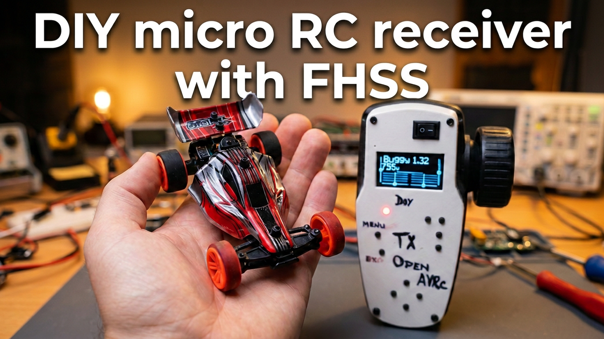
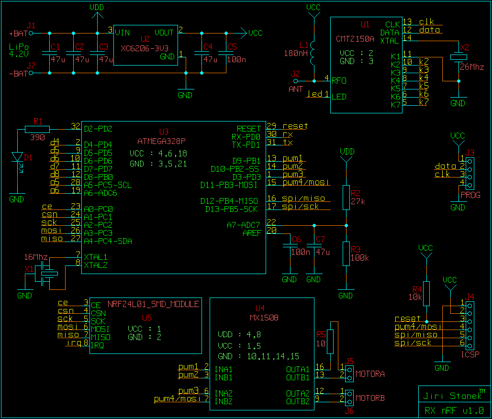
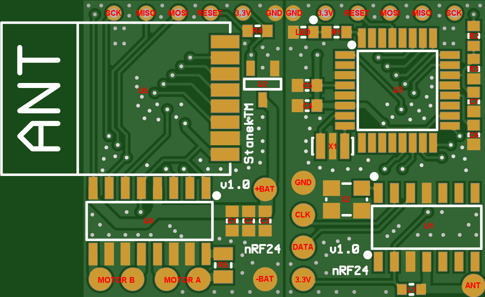
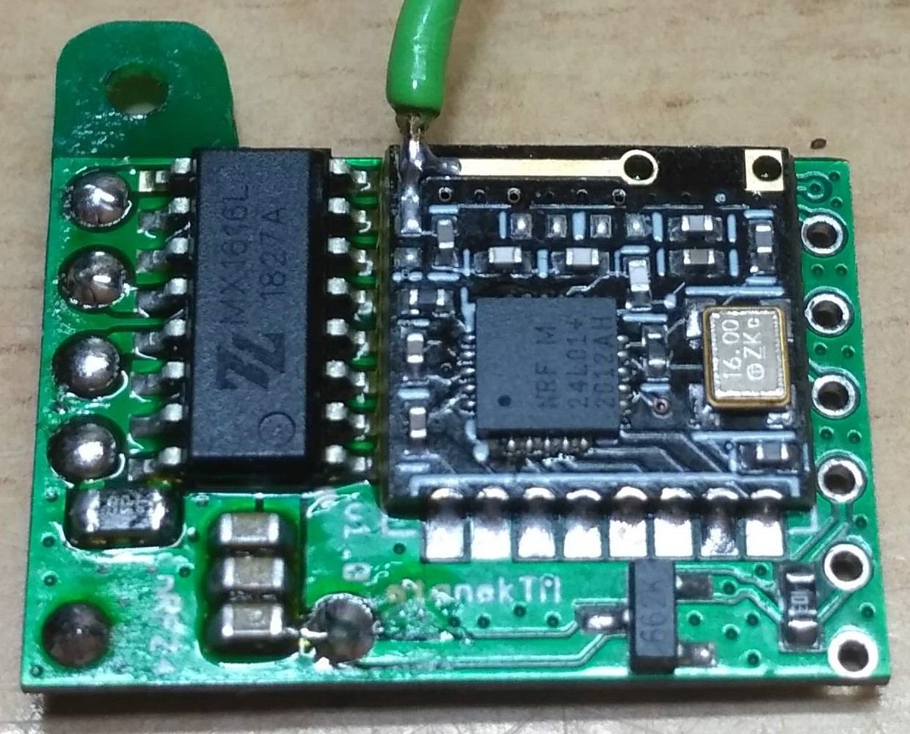
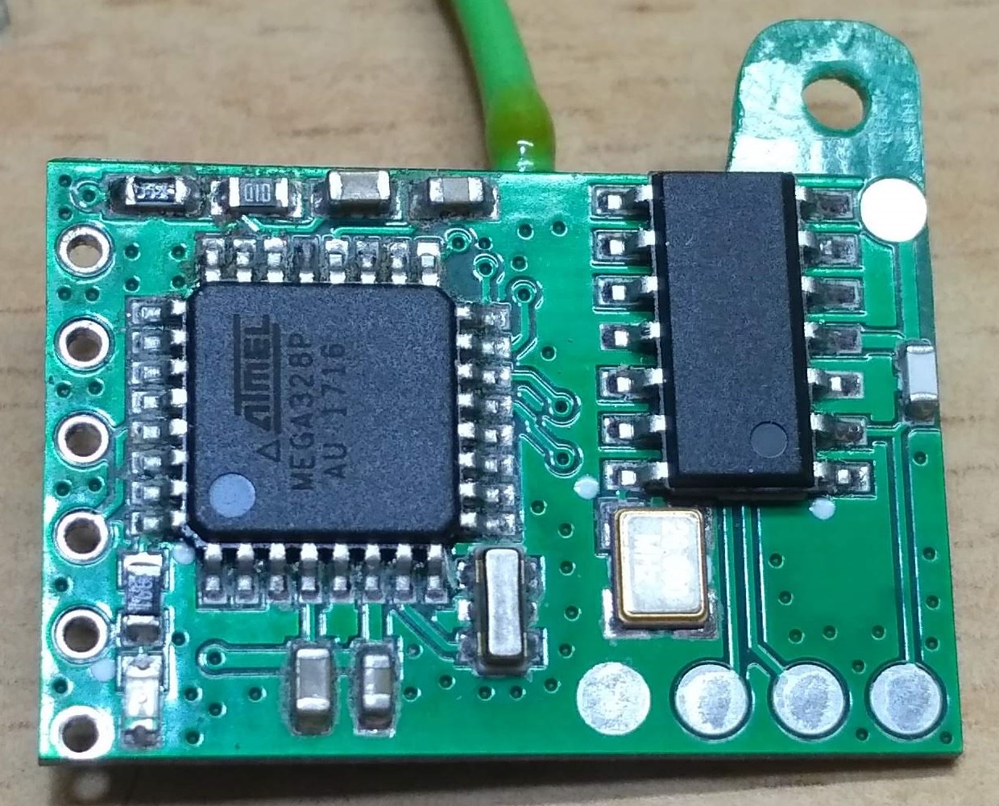
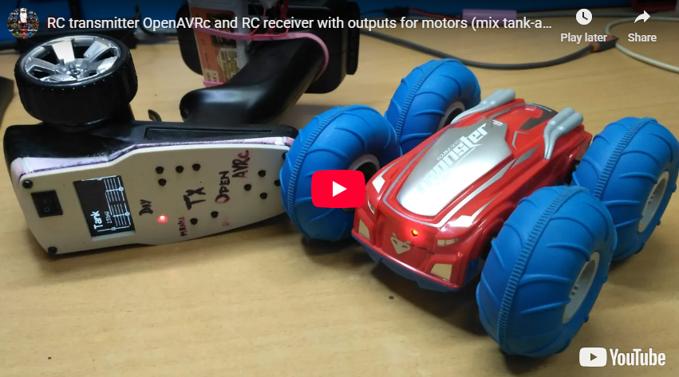
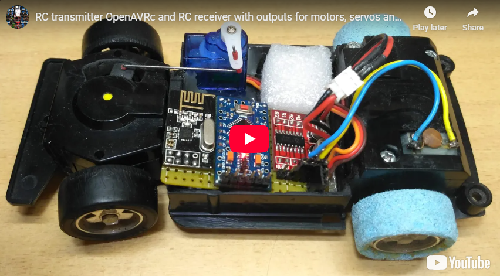

# RC receiver with FHSS
Universal RC receiver with frequency hopping (FHSS) and two-way telemetry (Auto-ACK Payload), built on the Arduino platform

## Features and functions
* **FHSS** Rapid hopping between 4 strong RF channels (12, 40, 76, 88) outside the main WiFi frequencies
* **Transmission rate** 1 Mbps (for full support of the newer nRF52 generation)
* **Constant latency / period** 4.5 ms (222 Hz)
* **Fail-Safe**
  * Saving servo emergency positions to EEPROM memory (triggered from the transmitter)
  * In the event of a signal loss exceeding 1000 ms, the receiver sets all servos to failsafe positions and the motors to a fixed neutral setting (1500 us, idling / brake)
* **RC channels** from 2 to 14 with 16-bit pulse resolution (1000–2000 us)
  * Up to 14 PWM servo outputs (ATmega328PB only)
  * 2 independent motor outputs, or a combination of 1 to 2 motor outputs with servo outputs
* **Telemetry**
  * 2 analog inputs with 8-bit resolution (0–255)
  * RSSI counting successfully delivered packets with 8-bit resolution limited to (0–100)
* **Status LED mode**
  * Permanently lights: Normal operation, the signal is fine, and the batteries are charged
  * Rapid flashing (100 ms): Fail-Safe activated (signal loss lasts longer than 1000 ms)
  * Medium flashing (300 ms): Low battery voltage A1 or A2
  * Slow flashing (500 ms): Saving emergency servo positions to EEPROM memory is in progress

## Supported hardware
* Transceiver Nordic Semiconductor nRF24L01+
* AVR ATmega328P microcontroller or the more advanced ATmega328PB
* You can use any motor driver that utilizes 2 PWM control inputs for forward and reverse operation e.g. Mixic for two motors (MX1208, MX1508, MX1515, MX1616, MX1919,...) or one engine (MX116, MX608, MX512, MX612,...)
  * Note: The code is not suitable for motor drivers that use 1 PWM signal and 2 logic inputs for forward and reverse direction per motor e.g. Toshiba Semiconductor TB6612FNG (it unnecessarily uses 2 extra pins to control two motors!) 
* Supplementary hardware: For some PCBs added transponder for wheel measurement CMOSTEK CMT2150A

## Compatible with RC transmitters
* [**OpenAVRc**](https://github.com/Ingwie/OpenAVRc_Dev)
* [**DIY-Multiprotocol-TX-Module (EdgeTX/OpenTX)**](https://github.com/stanekTM/TX_Multiprotocol_Stanek) from my fork
* [**TX_nRF24_FHSS_2ch_OLED**](https://github.com/stanekTM/TX_nRF24_FHSS_2ch_OLED)
* [**TX_nRF24_FHSS_Xch_LED**](https://github.com/stanekTM/TX_nRF24_FHSS_Xch_LED)

## Receiver configuration description
Examples in the [**Config.h**](RX_nRF24_FHSS/Config.h) file
```
#define PIN_LED        2  // Define a pin other than A5
#define PIN_BATTERY_A1 A7 // Define an analog pin other than A6 (only A5 or A7 available)
#define PIN_BATTERY_A2 A6 // Define an analog pin other than A7 (only A5 or A6 available)

#define BATT_VOLTAGE_A1      4.2  // Set the maximum nominal voltage for battery A1
#define MONITORED_VOLTAGE_A1 3.45 // Set minimum alarm voltage for battery A1

#define BATTERY_A2               // Option to add a second battery
#define BATT_VOLTAGE_A2      8.4 // Set the maximum nominal voltage for battery A2
#define MONITORED_VOLTAGE_A2 6.9 // Set minimum alarm voltage for battery A2

#define SERVO                             // Define servo outputs (up to 14 servos, ATmega328PB only)
const uint8_t pins_servo[] = {2, 3, ...}; // Select pins for servos

#define MIX_TANK // Option to add a Tank / Arcade mix for two motors

#define NUM_MOTORS 1 to 2 // Define the number of motors

#define TIMER..30HZ to 31250HZ // Frequency setting according to motor type

// Setting motor limits in % (0 to 100)
#define REACTION_MOTOR   15  // Motor starting response. Prevents initial magnetic resistance of the rotor
#define MAX_FWD_MOTOR_T2 100 // Maximum permitted power for the forward direction
#define MAX_REV_MOTOR_T2 50  // Maximum permitted power for the reverse direction (e.g., safer reversing)
#define BRAKE_MOTOR_T2   0   // Braking force during stopping (0 = idling, 100 = maximum brake)
```

## Photo gallery and video samples
### Buggy 1:32 (2 motors)

<table border="0">
<tr>
<td width="50%">
<a href="https://youtu.be/E0pgMNPuYU4"></a>
</td>
</tr>
</table>

<table border="0">
<tr>
<td width="50%">

</td>
<td width="50%">

</td>
</tr>
</table>

<table border="0">
<tr>
<td width="50%">

</td>
<td width="50%">

</td>
</tr>
</table>

### Eachine Monster (2 motors with mix)

<table border="0">
<tr>
<td width="50%">
<a href="https://youtu.be/AYgY5UkVnUM"></a>
</td>
</tr>
</table>

### Ferari F-40 (1 motor + 1 servo)

<table border="0">
<tr>
<td width="50%">
<a href="https://youtu.be/jPN5YdQ-3K0"></a>
</td>
</tr>
</table>
